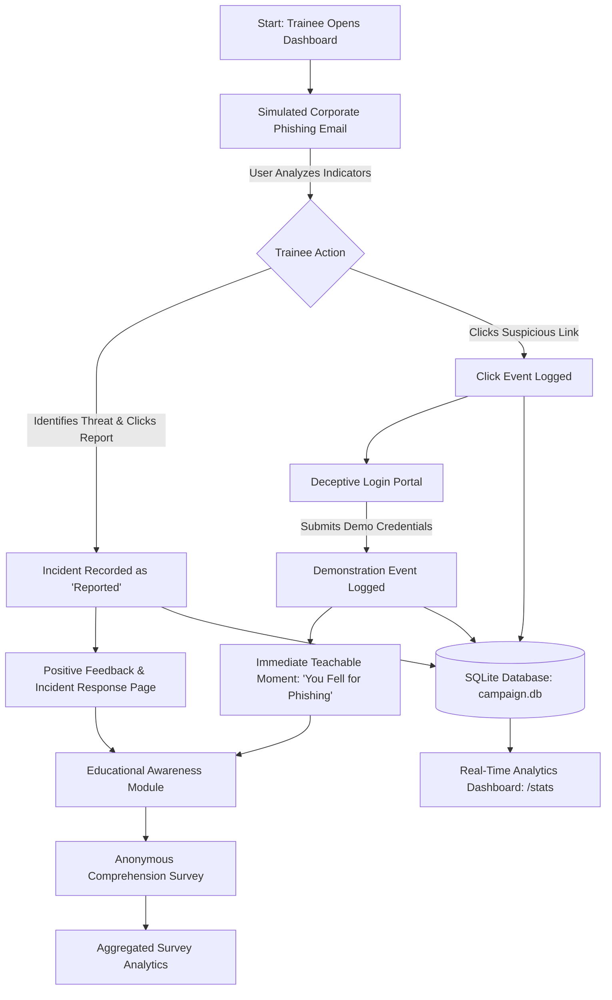
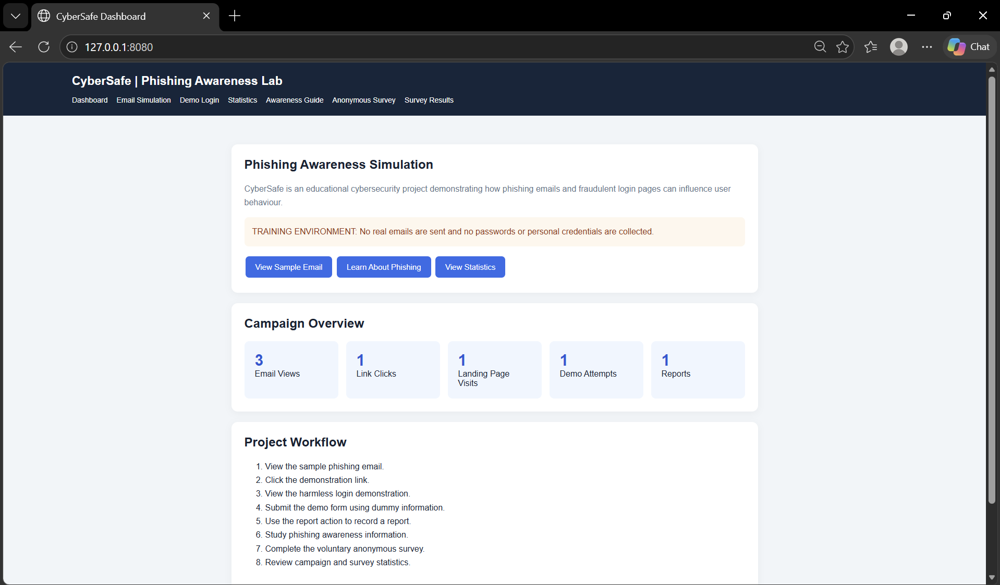
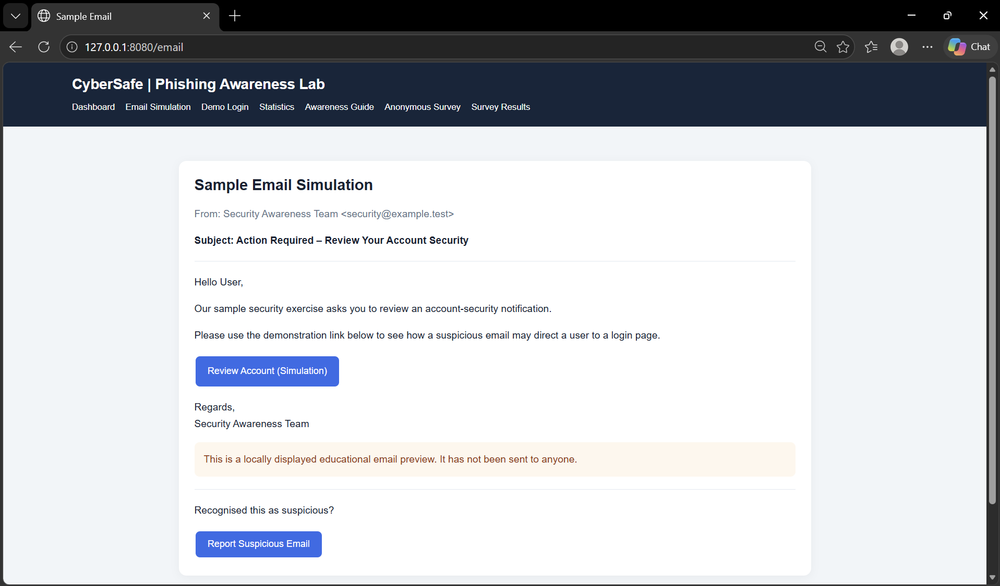
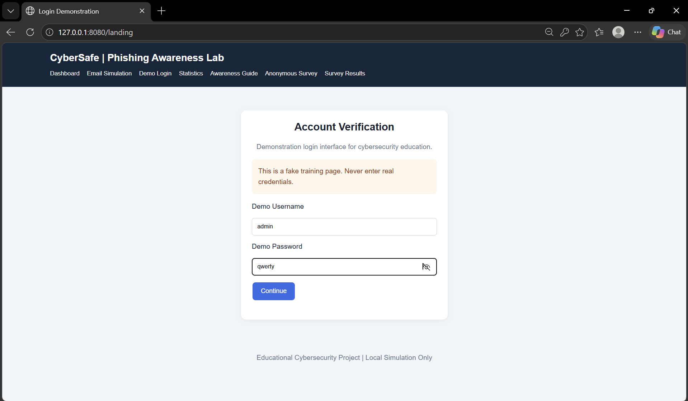
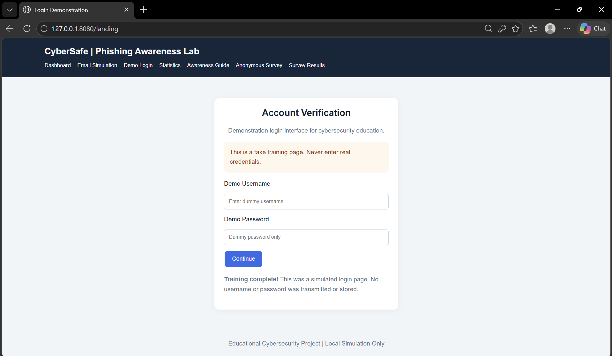
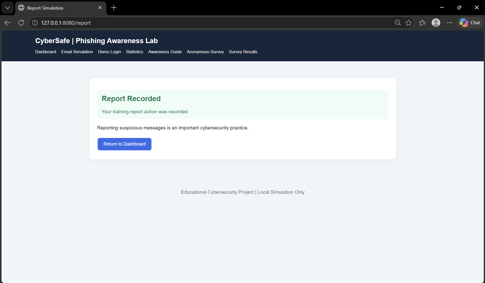
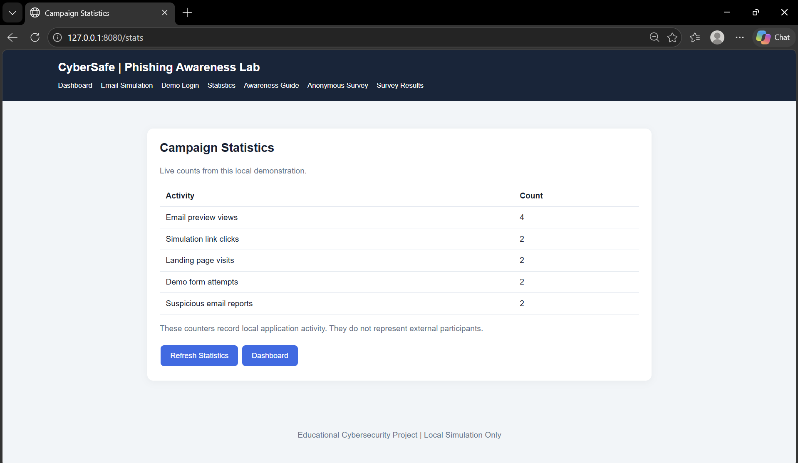
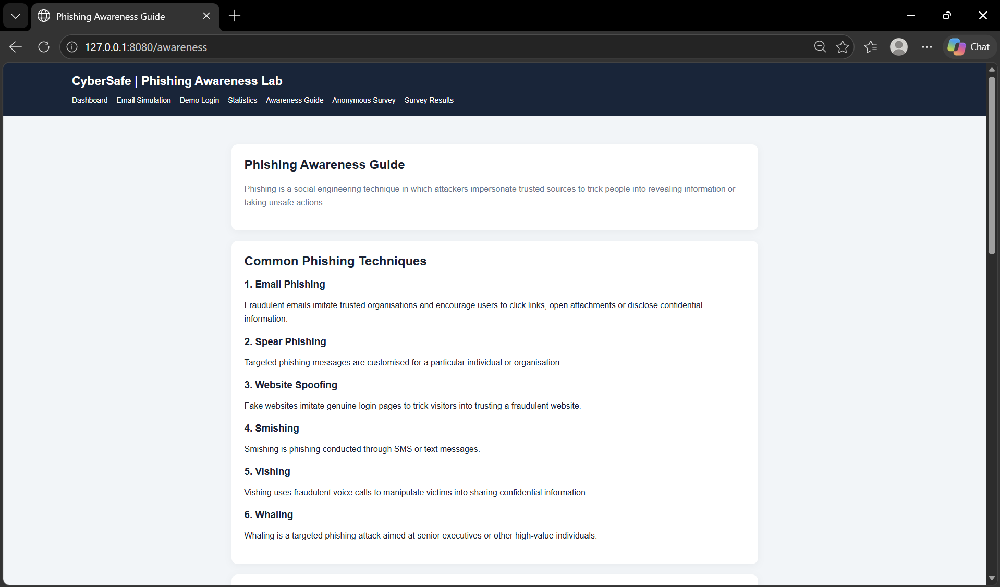
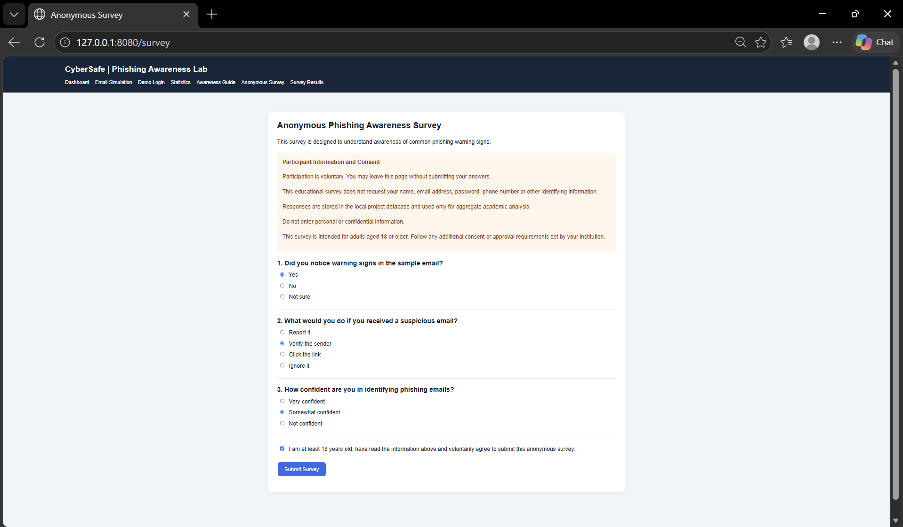
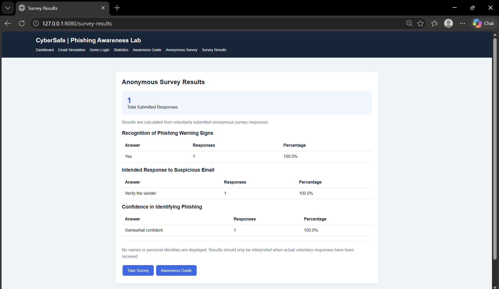

# 🛡️ CyberSafe: Phishing Awareness Simulation & Training Lab

[](https://www.python.org/)
[](LICENSE)
[]()
[]()
[]()

> **Phishing Awareness Simulation Using Social Engineering Techniques**  
> A lightweight, realistic, and ethical local training environment designed to simulate phishing scenarios, measure user susceptibility, promote incident reporting, and deliver actionable security awareness training.

---

## 📌 Table of Contents

- [Overview](#-overview)
- [Key Features](#-key-features)
- [System Architecture & Flow](#-system-architecture--flow)
- [Visual Walkthrough & Screenshots](#-visual-walkthrough--screenshots)
- [Application Endpoints](#-application-endpoints)
- [Installation & Quickstart](#-installation--quickstart)
- [Project Directory Structure](#-project-directory-structure)
- [Security & Ethical Standards](#-security--ethical-standards)
- [Research & Deliverables](#-research--deliverables)
- [Authors & License](#-authors--license)

---

## 📖 Overview

Human error and deceptive social engineering tactics account for over 80% of cybersecurity breaches worldwide. **CyberSafe** is an interactive, browser-based cybersecurity training platform developed to bridge the gap between technical defense mechanisms and human awareness. 

Built using Python's standard HTTP server and an SQLite backend with **zero external third-party dependencies**, CyberSafe provides an isolated, risk-free environment where participants experience realistic phishing indicators, evaluate suspicious communications, observe simulated credential harvesting risks, and learn proactive defensive countermeasures.

---

## ✨ Key Features

- **📧 Realistic Phishing Simulation**: Simulates targeted corporate security notifications featuring deceptive domain names, false urgency cues, and authentic UI styling.
- **🎣 Harmless Credential Demonstration**: Safely illustrates how attackers capture login credentials without persisting sensitive user data.
- **🚨 One-Click Incident Reporting**: Features an integrated incident reporting mechanism that tracks proactive defense rates across users.
- **📊 Real-Time Campaign Analytics**: Interactive dashboard presenting metrics on total email views, link clicks, submission attempts, and reported incidents.
- **📘 Interactive Awareness Guide**: In-depth module covering email red flags, URL inspection techniques, password hygiene, and Multi-Factor Authentication (MFA).
- **📝 Anonymous Evaluation Survey**: Embedded pre/post training survey capturing user confidence, red flag recognition, and intended follow-up actions.
- **⚡ Zero Configuration Setup**: Runs instantly out-of-the-box on standard Python with built-in SQLite persistence.

---

## 🔄 System Architecture & Flow



---

## 🖼️ Visual Walkthrough & Screenshots

### 1. Main Management Dashboard
The central command hub displaying campaign indicators, status cards, and quick navigation.


---

### 2. Phishing Email Simulation
Realistic email interface demonstrating deceptive urgency and social engineering cues.


---

### 3. Harmless Demo Credential Harvest & Teachable Moment
Demonstrating the mechanics of credential harvesting without saving passwords, followed by immediate educational feedback.
| Simulated Login Portal | Demonstration Completed |
| :---: | :---: |
|  |  |

---

### 4. Incident Reporting & Real-Time Campaign Statistics
Empowering trainees to report threats and visualizing organizational resilience metrics in real time.
| Phishing Incident Recorded | Campaign Analytics Dashboard |
| :---: | :---: |
|  |  |

---

### 5. Educational Security Awareness Guide
Comprehensive training guide outlining red flags, URL validation, and defensive practices.


---

### 6. Anonymous Feedback Survey & Results
Evaluating participant comprehension and analyzing post-simulation behavioral change.
| Anonymous Survey Form | Aggregated Survey Results |
| :---: | :---: |
|  |  |

---

## 🌐 Application Endpoints

| Endpoint | Method | Description |
| :--- | :---: | :--- |
| `/` | `GET` | Main Dashboard featuring navigation and simulation summary. |
| `/email` | `GET` | Simulated phishing email interface with active simulation triggers. |
| `/click` | `GET` | Endpoint tracking link clicks; redirects directly to the landing page. |
| `/landing` | `GET` | Mock single sign-on / login portal for demonstration purposes. |
| `/submit` | `POST` | Safely handles demo form submission without logging plaintext credentials. |
| `/report` | `GET` | Endpoint tracking proactive incident reporting by trainees. |
| `/stats` | `GET` | Live campaign statistics dashboard with click/report breakdown. |
| `/awareness` | `GET` | Detailed educational guide on phishing detection and best practices. |
| `/survey` | `GET` | Anonymous comprehension and awareness feedback survey form. |
| `/survey-submit` | `POST` | Processes and persists survey responses into SQLite. |
| `/survey-results` | `GET` | Visual display of aggregated survey metrics and responses. |
| `/api/stats` | `GET` | REST API returning real-time campaign metrics in JSON format. |

---

## 🚀 Installation & Quickstart

### Prerequisites
- **Operating System**: Windows 10/11, macOS, or Linux
- **Python**: Version `3.9` or newer (Python standard library only)
- **Web Browser**: Chrome, Firefox, Edge, or Safari

### Step-by-Step Instructions

1. **Clone the Repository**:
   ```bash
   git clone https://github.com/sjainam1811-l/Phishing_Awareness_Project.git
   cd Phishing_Awareness_Project
   ```

2. **Verify Environment**:
   No external packages or `pip install` commands are needed! Verify Python is available:
   ```bash
   python --version
   ```

3. **Launch the Application**:
   ```bash
   python app.py
   ```

4. **Access the Web Interface**:
   Open your browser and navigate to:
   ```
   http://127.0.0.1:8080
   ```

5. **Stop the Application**:
   Press `Ctrl + C` in your terminal window to safely shut down the local server.

---

## 📁 Project Directory Structure

```plaintext
Phishing_Awareness_Project/
│
├── Screenshot/                      # Documentation and interface screenshots
│   ├── 01_dashboard.png             # Main landing dashboard
│   ├── 02_email_simulation.png      # Phishing email scenario
│   ├── 03_demo_login.png            # Mock credential harvesting portal
│   ├── 04_demo_login_completed.png  # Immediate educational feedback
│   ├── 05_report_recorded.png       # Incident reporting confirmation
│   ├── 06_campaign_statistics.png   # Campaign metrics visualization
│   ├── 07_awareness_guide.png       # Security awareness guide
│   ├── 08_anonymous_survey.png      # Post-simulation survey form
│   ├── 09_survey_submitted.png      # Survey submission confirmation
│   └── 10_survey_results.png        # Survey analytics and metrics
│
├── reports/                         # Research and academic documentation
│   ├── CyberSafe_Project_Report.pdf # Formatted academic project research report
│   ├── CyberSafe_Project_Report.docx# Source project research report
│   └── CyberSafe Phishing Lab.pptx  # Project presentation and walkthrough slides
│
├── app.py                           # Core Python application server & HTTP handler
├── campaign.db                      # Local SQLite database (pre-seeded with demo data)
├── requirements.txt                 # Project environment requirements specification
├── LICENSE                          # MIT Open Source License
└── README.md                        # Comprehensive project documentation
```

---

## 🔒 Security & Ethical Standards

This simulation is strictly designed for **educational, academic, and internal organizational awareness training**:

- **No External Communication**: The tool does not transmit emails over external SMTP networks. All operations remain entirely on localhost (`127.0.0.1`).
- **Zero Credential Persistence**: Form fields never store entered usernames or passwords in plaintext or hashed format. Only high-level event timestamps are recorded.
- **Privacy First**: Survey answers are anonymized and cannot be correlated with specific IP addresses or identities.
- **Isolated Sandbox**: Runs entirely on a local SQLite database that can be reset at any time by deleting `campaign.db`.

---

## 📚 Research & Deliverables

This repository contains the complete academic deliverables for the Major Project in Cyber Security (Academic Year 2026–2027):
- **Full Research Report**: Available in [`reports/CyberSafe_Project_Report.pdf`](reports/CyberSafe_Project_Report.pdf) and [`reports/CyberSafe_Project_Report.docx`](reports/CyberSafe_Project_Report.docx), covering social engineering psychology, threat modeling, attack vectors, and human-centric security mitigation.
- **Presentation Deck**: Located in [`reports/CyberSafe Phishing Lab.pptx`](reports/CyberSafe%20Phishing%20Lab.pptx), detailing the project architecture, implementation phases, and live demonstrations.

---

## 👨‍💻 Authors & Acknowledgments

- **Jainam Shah** - [GitHub Profile](https://github.com/sjainam1811-l)
- **Mahi Patel**

Developed as a Major Cybersecurity Project (2026–2027).

---

## 📄 License

This project is open-source and distributed under the [MIT License](LICENSE).
